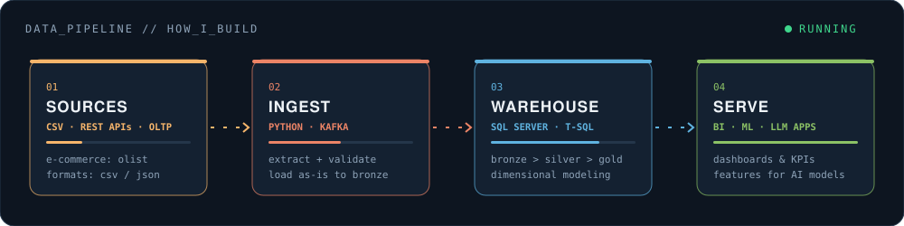
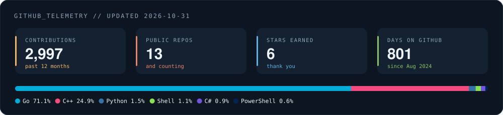

  

  

  

## ABOUT ME

Student at **VNUHCM University of Science**, working toward **Data Engineering** and **AI Engineering**.

I like the part of the stack most people never see: pulling data out of messy sources, modeling it into a warehouse, and keeping pipelines reliable enough that the dashboards and the AI models built on top can actually be trusted.

On the side, I build small tools and tweaks for myself.

---

## HOW I BUILD DATA PIPELINES

  

---

## TECH STACK

### Languages

  
  
  
  
  
  
  
  
  

### Databases

  
  
  
  
  
  
  
  

### Processing & Streaming

  
  
  
  
  
  
  

### Orchestration & Transformation

  
  

### Warehouse & Lakehouse

  
  
  
  
  

### AI & Machine Learning

  
  
  
  
  
  
  
  
  
  
  
  
  
  

### BI & Analytics

  
  
  
  
  

### Cloud & DevOps

  
  
  
  
  
  
  
  
  

### Tools

  
  
  
  

---

## GITHUB TELEMETRY

  

  

### RECENTLY PUSHED

<!-- recent_repos starts -->
- [**tdrive**](https://github.com/ndgthuan/tdrive) &mdash; TDrive - Go + Wails desktop app (Telegram as cloud d... `Go` 2026-10-31
- [**olist**](https://github.com/ndgthuan/olist) &mdash; Working with pipeline `Python` 2026-10-30
- [**quietbattery**](https://github.com/ndgthuan/quietbattery) &mdash; TrollStore app that hides the iOS low-battery (20%/1... `Python` 2026-10-18
- [**jello**](https://github.com/ndgthuan/jello) `C++` 2026-10-11
- [**warehouse**](https://github.com/ndgthuan/warehouse) &mdash; Bulding a mordern data warehouse with SQL server, in... `TSQL` 2026-08-01
- [**pycourse**](https://github.com/ndgthuan/pycourse) `Python` 2025-11-15
<!-- recent_repos ends -->

---

## CONTACT

Happy to talk about data pipelines, warehouses, AI systems, or anything I've built here.

  
  
  

---

## QUOTE

  

---

## CONTRIBUTION SNAKE

  <picture>
    <source media="(prefers-color-scheme: dark)" srcset="https://raw.githubusercontent.com/ndgthuan/ndgthuan/output/github-contribution-grid-snake-dark2.svg">
    
  </picture>

Header, pipeline, telemetry and quote cards are generated daily by <a href="./scripts/build.py">scripts/build.py</a>.

